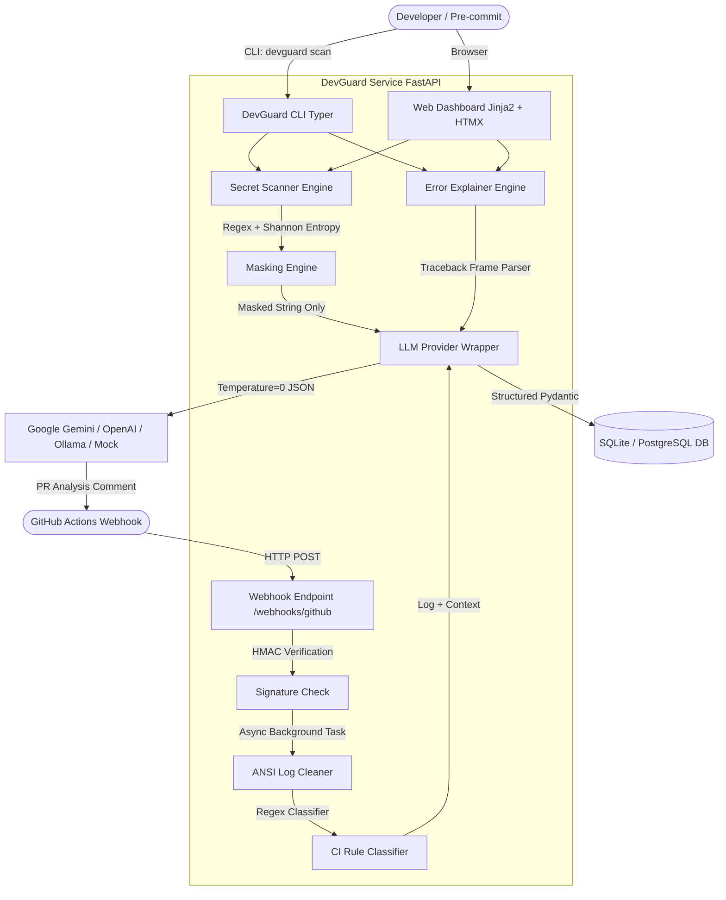

# 🛡️ AI DevGuard

**Automated Secret Scanner, Error Explainer, and CI Failure Analyzer for DevSecOps**

AI DevGuard is a production-ready Python service (FastAPI + SQLAlchemy) and CLI tool designed to protect developers from committing secret keys, diagnose Python runtime exceptions, and automatically analyze GitHub Actions CI pipeline failures.

---

## 🏗️ Architecture



---

## 🛠️ Tech Stack & Dependencies

- **Language:** Python 3.12+
- **API & Web Framework:** FastAPI, Uvicorn, Pydantic v2, Pydantic-Settings
- **Frontend Dashboard:** Jinja2 Templates, HTMX, Glassmorphism Dark CSS
- **Database & ORM:** SQLAlchemy 2.0, Alembic, SQLite (dev) / PostgreSQL (prod)
- **CLI & Formatting:** Typer, Rich
- **LLM Wrapper:** Custom async HTTP wrapper supporting Google Gemini (`gemini-3.1-flash-lite`), OpenAI (`gpt-4o-mini`), Ollama, and an offline deterministic `MockLLMClient`.

---

## ⚡ Quickstart & Local Setup

### 1. Clone & Install Dependencies
```bash
git clone https://github.com/your-username/DevGuard.git
cd DevGuard

# Create and activate virtual environment
python -m venv .venv
source .venv/bin/activate  # On Windows: .venv\Scripts\activate

# Install package in editable mode with development dependencies
pip install -e .[dev]
```

### 2. Environment Configuration
Copy the template environment file:
```bash
cp .env.example .env
```

Configure your preferred LLM provider in `.env`:
```ini
# To test offline without API key:
LLM_PROVIDER=mock

# To use Google AI Studio Gemini key:
LLM_PROVIDER=gemini
LLM_MODEL=gemini-3.1-flash-lite
LLM_API_KEY=your_gemini_api_key_here
```

### 3. Run FastAPI Web Service & Dashboard
```bash
uvicorn app.main:app --reload --port 8000
```
Open your browser at [http://localhost:8000/dashboard](http://localhost:8000/dashboard) to view the interactive web interface!

---

## 💻 CLI Usage

### Secret Scanner
Scan a directory or file for exposed secret keys and tokens:
```bash
devguard scan .
```

### Error Explainer
Diagnose a Python traceback file or string:
```bash
devguard explain "Traceback (most recent call last): ... ZeroDivisionError: division by zero"
```

### Pre-commit Hook Integration
Add to your `.pre-commit-config.yaml`:
```yaml
repos:
  - repo: local
    hooks:
      - id: devguard-secret-scan
        name: DevGuard Secret Leak Scanner
        entry: python -m cli.main scan .
        language: system
        pass_filenames: false
```
Run locally: `pre-commit run --all-files`

---

## 🧪 Tests & Reproducible Evaluation Suite

### 1. Run Unit Tests (Pytest)
Runs full offline test suite without needing an API key:
```bash
pytest -v
```

### 2. Run Reproducible Evaluation Benchmark
Our research question: *Does adding an LLM on top of rule-based parsing find secrets, explain errors, and identify CI failure root causes more accurately than rules alone or an LLM given raw input?*

Execute the single evaluation benchmark command:
```bash
python eval/run_experiments.py
```
This automatically runs all 3 benchmarks and generates 3 CSV result tables:
- `eval/results_secrets.csv`: Precision, Recall, F1 Score, False Alarm Rate comparison across Rules-only vs Detect-Secrets vs Rules + LLM Triage.
- `eval/results_ci.csv`: Failure category accuracy, average runtime, and token usage comparison across Rule Classifier vs Raw Log + LLM vs Cleaned Log + Rules + LLM.
- `eval/results_errors.csv`: Correct cause rate and valid JSON output rate comparison across Raw Error Text + LLM vs Parsed Frame + Code + LLM.

---

## 🎓 Student Presentation Guide (What Each Teammate Can Explain)

- **Teammate 1 (Security & Secret Scanner)**: Explains Shannon entropy math, high-precision regex rules, secret value masking (`AKIA****XYZ`), allowlist heuristics, and how LLM triage reduces false alarm rates.
- **Teammate 2 (CI Failure Analyzer & Webhooks)**: Explains GitHub HMAC SHA-256 signature verification (`X-Hub-Signature-256`), ANSI log cleaning, rule-based pre-classification, async background worker tasks, and GitHub PR commenting.
- **Teammate 3 (Error Explainer & Unified LLM Wrapper)**: Explains Python traceback parsing, nearby source line extraction, structured Pydantic schema generation at `temperature=0`, and mock LLM provider architecture for zero-cost offline testing.
- **Teammate 4 (Web Dashboard, CLI & Evaluation Benchmark)**: Explains HTMX dynamic UI updates, pre-commit hook git integration, evaluation metrics (Precision/Recall/F1), and experimental results proving rules + LLM superior performance.

---

## ⚠️ Known Limitations

1. **Active Credential Verification Out-of-Scope**: DevGuard detects secret patterns and entropy, but does not execute live network calls to verify if keys are active (prevents accidental lockout/revocation).
2. **Multi-Stage CI Cascades**: If a CI job fails due to an error in a previous workflow job that was suppressed, rule pre-classification targets the final failing log step.
3. **Complex Dynamic Python Exceptions**: Tracebacks generated inside dynamic `eval()` or compiled C-extensions may lack source line numbers on disk.
